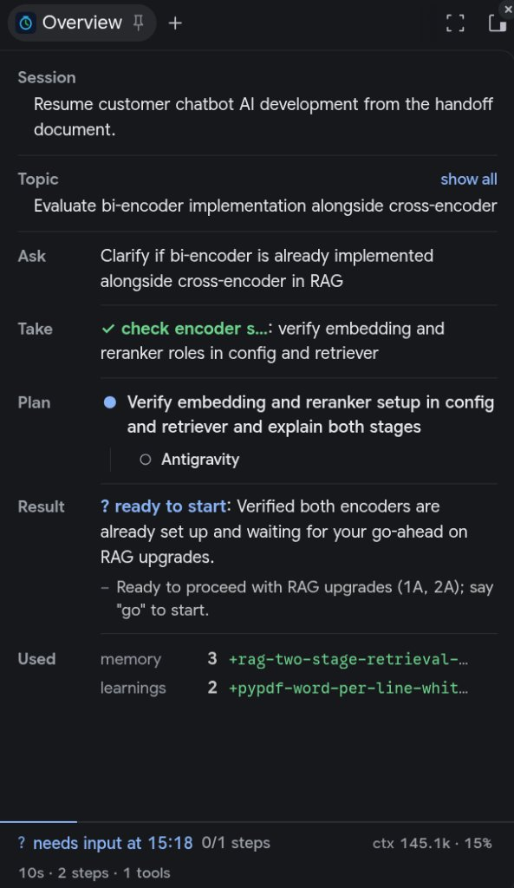
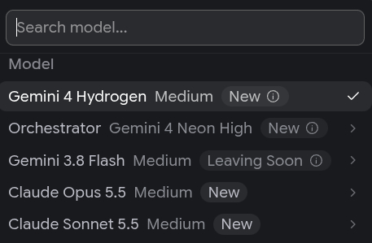
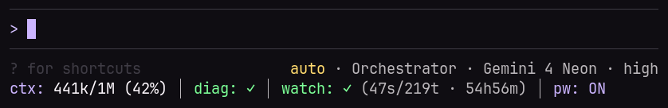

# gravityzilla

Antigravity setup with comfortable in mind. Supports both Antigravity Desktop and CLI. 

> **Alpha:** Expect rough edges — this is personal tooling, not a polished release. Tested on Linux; Windows is unsupported.

## Install

Best way to install is to let your AI agent handle it:

```text
Clone https://github.com/segfawlt/gravityzilla.git to ~/gravityzilla, inspect available components with ./install.sh --list --json, install what fits this machine, and verify with ./install.sh --status --json.
```

Or run interactively yourself:

```bash
git clone https://github.com/segfawlt/gravityzilla.git ~/gravityzilla && ~/gravityzilla/install.sh
```

See [docs/INSTALL.md](./docs/INSTALL.md) for flags, target paths, RTK detection, Desktop patches, and manual steps.

---

## Margin Overview Sidebar



- **Session & Topic:** Background summary of your current task and collapsible topic history (`show all`).
- **Ask & Take:** `Ask` echoes your request; `Take` shows the agent's pre-work stance (`✓ clear`, `! check first`, `✗ data loss`, `? needs repro`).
- **Plan & Subagents:** Live `update_steps` checklist with nested subagent and swarm trees.
- **Result & Used:** Turn outcome triage (`✓ clear`, `? needs input`, `! caveats`, `✗ blocked`) and a `Used` drawer for touched files.
- **Live HUD Footer:** 1-second context gauge (`ctx`), step count, and Watchdog timer.

<br clear="all" />

---

## Desktop Patches (`agy-desktop-patch`)



- **Model Picker Search:** Live search input inside model selector (`Ctrl+N`/`Ctrl+P` + typeahead).
- **Model Display List:** Hide unused models under **Settings → Models & Usage** (persisted across restarts).

<br clear="all" />

| Patch | Effect |
| :--- | :--- |
| `model-search` | Live model picker search and visibility toggles |
| `top-bar` | Hide Desktop hub top bar (`.agy-shell > div.shrink-0`) for vertical space |
| `overview` | Pin and auto-open Margin **Overview** once per conversation |

See [Desktop Patches](./docs/INSTALL.md#desktop-patches) for `status` / `check` / `apply` / `restore` commands.

---

## CLI Status Line (`agy-statusline`)



| Segment | Shows |
| :--- | :--- |
| **Git & Worktrees** | Branch, dirty state, active worktrees |
| **Context (`ctx:`)** | Post-`CHECKPOINT` reverse transcript scan with model limits (`<15 ms`) |
| **Live Telemetry** | Unfixed diagnostics errors, Watchdog steps/tools, toggleable MCP state |

---

## Core Features

| Feature | Tool / Path | What it does |
| :--- | :--- | :--- |
| **Diagnostics** | `agy-diagnostics` | `<50 ms` post-edit syntax checks (`PreInvocation` ephemeral inject + `Stop` safety net) |
| **Memory** | `agent-memory` | 2-stage memory under `~/.agents/memories/` (`memory.db` FTS5 + `~280`-token `SessionStart`) |
| **Watchdog** | `agy-watch` | Loop circuit-breaker (`>=3` identical calls), `ABAB` oscillation, error thrash, hang cleanup |
| **Stats** | `agy-stats` | Zero-LLM `/stats` slash commands (`5h`, `today`, `days`, `quota`) + web dashboard (`:3872`) |
| **RTK** | `rtk-safe-hook.py` | Reuses or downloads latest `rtk-ai/rtk` + Git/Shell safety gate (blocks `.env`, bad worktrees) |
| **Playwright** | `config/plugins/playwright/` | On-demand browser audit MCP (disabled by default) |
| **Rules & Settings** | `config/GEMINI.md` | Pair-programming contract, `ultracave` style, Git hygiene, safe `settings.json` template |

---

## Skills

| Group | Skills | Purpose |
| :--- | :--- | :--- |
| **Learnings** | `compound`, `compound-refresh` | Capture durable fixes to `docs/learnings/`; prune or promote 3x-hit lessons |
| **Worktrees** | `ship` (`git-wt-sync`) | Audit, ghost-conflict check, rebase/merge, test, prune, push |
| **Engineering** | `audit`, `blast-radius`, `correct`, `create-verification-skill`, `pr`, `review`, `systematic-debugging` | Deep audits, impact checks, root-cause debugging, PR prep, structural enforcement |
| **Frontend UI** | `taste-skill`, `avoid-ai-design`, `hallmark`, `ui-demo-prototype` | Anti-slop UI design, CDP visual inspection, scratch port prototypes |
| **Telemetry** | `stats` | `/stats onboard` setup and natural-language quota queries |

---

## Requirements

| Platform | Support | Core dependencies |
| :--- | :--- | :--- |
| **Linux** | Full (`x86_64`, `aarch64`) | Python `>= 3.11`, Node.js `>= 22.13`, `git`, `curl`, `agy` |
| **Windows** | Portable subset ([install.ps1](./install.ps1)) | Python `>= 3.11`, Node.js `>= 22.13`, `agy` (`rules`, `skills`, `margin`, `diagnostics`, `stats`, `playwright`) |

Full optional tools and installer reference: [docs/INSTALL.md](./docs/INSTALL.md).
